# Architecture & Data Flow Topology Map

> **A comprehensive block diagram illustrating the entire multi-sensor bus and UAV data flow.**

---

## 1. Multi-Sensor Bus & UAV Data Flow Architecture

The block diagram below illustrates the end-to-end data flow topology of the tactical autonomous UAV, detailing sensor ingress pathways, edge computing inference, real-time flight control avionics, secure air-to-ground telemetry, and hardware cybersecurity boundaries.

```mermaid
flowchart TB
    %% =========================================================================
    %% ARCHITECTURE & DATA FLOW TOPOLOGY MAP
    %% =========================================================================

    subgraph SEC_GROUND ["Ground Segment & External Terminals"]
        direction LR
        EXT_OGT["Optical Ground Terminal (OGT)<br/>• Line-of-Sight Laser Reception<br/>• PAT Direct Optical Tracking"]
        EXT_GCS["Ground Control Station (GCS)<br/>• Encrypted SDR RF Backup Link<br/>• Frequency-Hopping Telemetry & C2"]
    end

    subgraph SENSOR_BUS ["Multi-Sensor Ingress Bus (Perception & Transducers)"]
        direction TB
        SEN_CAM["Stabilized Multi-Spectral Gimbal [MOD-02]<br/>• Daylight CMOS (4K) + LWIR Bolometer (640x512)<br/>• Direct Inertial Stabilization"]
        SEN_LIDAR["Micro-LiDAR Altimeter [STUDY-NODE-11]<br/>• Ground Clearance & Precision AGL Ranging"]
        SEN_GPR["Micro-Ground Penetrating Radar [STUDY-NODE-12]<br/>• Subsurface Anomaly & Cache Detection"]
        SEN_ACOUSTIC["4-Element Acoustic Array [STUDY-NODE-13]<br/>• Impulse Gunfire Transducers (TDoA)"]
        SEN_CBRN["Digital CBRN Sniffer [STUDY-NODE-14]<br/>• Airborne Hazardous Agent & Chemical Sensing"]
        SEN_IMU["High-Rate Tactical IMU [STUDY-NODE-16]<br/>• Low-Drift Gyros & Tri-Axial Accelerometers"]
        SEN_SDR["Wideband SDR RF Front-End [STUDY-NODE-15]<br/>• 400 MHz - 6 GHz Ingress Antenna Array"]
    end

    subgraph EDGE_COMPUTE ["Heterogeneous Edge Compute Fabric [STUDY-NODE-09] (Zero-Cloud)"]
        direction TB
        COMP_AI["Edge Intelligence Engine (EDGE-AI) [MOD-03]<br/>• TensorRT INT8 CNN Inferencing<br/>• Target Detection & Change Segmentation"]
        COMP_DSP["EW & Acoustic Tracking Engine (EW-DSP) [MOD-04]<br/>• Wideband RF Occupancy & Jammer TDoA<br/>• Acoustic Blast Localization"]
        COMP_VIO["GNSS-Denied Navigation (VIO-NAV) [MOD-01]<br/>• Visual-Inertial Odometry + DEM Terrain Match"]
        COMP_ROS["Swadeshi ROS 2 Middleware Core [STUDY-NODE-08]<br/>• Zero-Copy Shared Memory (shm)<br/>• Micro-XRCE-DDS Agent & Mission Executive"]
    end

    subgraph AVIONICS_CORE ["Real-Time Embedded Avionics & Flight Control"]
        direction TB
        NODE_PX4["PX4 Autopilot Flight Controller [STUDY-NODE-07]<br/>• Dedicated 32-Bit Aerospace MCU (STM32)<br/>• High-Rate Attitude Loops, EKF & Failsafe Watchdogs"]
        NODE_PMU["Smart Power Management Unit (PMU) [STUDY-NODE-19]<br/>• Multi-Rail DC Power & Li-Ion Thermal Conditioning"]
    end

    subgraph ACTUATION_BUS ["Actuation, Propulsion & Payload Effectors"]
        direction TB
        ACT_PROP["Electric Propulsion System [STUDY-NODE-17]<br/>• High-Torque BLDC Motors & -20°C Rated ESCs"]
        ACT_SURF["Flight Control Servos [STUDY-NODE-20]<br/>• Aerodynamic Control Surface Actuators"]
        ACT_POD["Precision Cargo Drop Pod [MOD-06]<br/>• Ballistic Release Mechanism & Wind Compensation"]
    end

    subgraph TELEMETRY_BUS ["Air-to-Ground Secure Communications"]
        direction TB
        COMM_FSO["Directional FSO Laser Transceiver [MOD-05]<br/>• High-Throughput Tactical Laser Data Link<br/>• Direct Gimbal Cross-Pointing (PAT)"]
    end

    subgraph CRYPTO_BUS ["Hardware Cybersecurity & Data Sovereignty"]
        direction TB
        NODE_ROT["Hardware Root of Trust (RoT) [STUDY-NODE-10]<br/>• Cryptographic Secure Boot Keys & Memory Encryption<br/>• Tamper Detection & Zero-Trace Electrical Sanitization"]
    end

    %% Sensor Bus Interconnects
    SEN_CAM -->|"MIPI CSI-2 (Multi-Lane Direct Memory Access)<br/>Raw YUV / RGB / 14-bit Thermal Video"| COMP_AI
    SEN_LIDAR -->|"High-Speed SPI / UART<br/>High-Rate Altitude Stream"| COMP_VIO
    SEN_IMU -->|"Direct Low-Latency SPI Bus<br/>Raw Delta Angles & Velocities"| NODE_PX4
    SEN_IMU -.->|"Synchronized High-Rate IMU Bus<br/>VIO Inertial Fusion Stream"| COMP_VIO
    SEN_GPR -->|"High-Speed SPI / USB 3.0<br/>Raw 16-bit IQ Radar Frame Ring"| COMP_DSP
    SEN_ACOUSTIC -->|"High-Speed SPI / USB 3.0<br/>Synchronized 4-Ch PDM Audio"| COMP_DSP
    SEN_CBRN -->|"I2C / UART Digital Bus<br/>Hazard Concentration & Alarm Flags"| COMP_ROS
    SEN_SDR -->|"Gigabit Ethernet / PCIe (VITA 49 Packets)<br/>Digitized IF Spectral Samples"| COMP_DSP

    %% Edge Compute Internal Interconnects
    COMP_AI <-->|"POSIX Shared Memory (Zero-Copy)<br/>Bounding Boxes & Target Vectors"| COMP_ROS
    COMP_DSP <-->|"POSIX Shared Memory / Sockets<br/>RF Emitters & Acoustic Bearings"| COMP_ROS
    COMP_VIO -->|"ROS 2 Odometry Topics<br/>Kinematic Pose & Drift Estimates"| COMP_ROS

    %% Avionics Bridge
    COMP_ROS <-->|"High-Speed UART / Industrial Ethernet<br/>MAVLink 2.0 / Micro-XRCE-DDS (Heartbeat Watchdog)"| NODE_PX4

    %% Actuation & Effectors
    NODE_PX4 -->|"Microsecond PWM / DShot Loops<br/>Closed-Loop RPM Commands"| ACT_PROP
    NODE_PX4 -->|"PWM / RS-485 Digital Bus<br/>Surface Deflection Commands"| ACT_SURF
    COMP_ROS -->|"Ballistic Target Coordinates<br/>& Local Wind Offset Vector"| ACT_POD
    NODE_PX4 -->|"Opto-Isolated Solid-State IO<br/>Dual-Redundant Release Interlock"| ACT_POD

    %% Power Distribution
    NODE_PMU -.->|"Regulated DC Power Rails (12V, 5V, 3.3V)"| EDGE_COMPUTE
    NODE_PMU -.->|"High-Current Propulsion Bus (Direct Pack)"| ACT_PROP

    %% Air-to-Ground Data Flow
    COMP_ROS -->|"Serialized ISR Intel & High-Value Imagery"| COMM_FSO
    COMM_FSO ==>|"Narrow-Beam Tactical Optical Laser Link<br/>(Primary High-Speed Line-of-Sight Data Link)"| EXT_OGT
    COMM_FSO -->|"RS-422 Serial Ingress<br/>PAT Gyro Angular Offsets"| SEN_CAM
    COMM_FSO -.->|"Automated Failover Trigger<br/>upon Cloud/Smoke Obscuration"| SEN_SDR
    SEN_SDR -.->|"Encrypted Frequency-Hopping RF Telemetry<br/>(Secondary Failsafe C2 & Status Link)"| EXT_GCS

    %% Cybersecurity Hard Boundaries
    NODE_ROT ==>|"Cryptographic Gate & Key Bus<br/>Enforced Secure Boot & Runtime Protection"| EDGE_COMPUTE
    NODE_ROT ==>|"Hardwired Tamper Ingress<br/>Instant Zero-Trace Solid-State Memory Wipe"| NODE_PX4
```

---

## 2. Multi-Sensor Bus Ingestion Protocols

| Ingest Vector | Source Sensor / Node | Hardware Bus Interface | Transport Protocol | Target Processor | Functional Role |
| :--- | :--- | :--- | :--- | :--- | :--- |
| **EO/IR Video** | Stabilized Gimbal (`MOD-02`) | MIPI CSI-2 (4-Lane) | Uncompressed DMA | Edge AI Engine (`MOD-03`) | Real-time target detection & tracking |
| **Laser Ranging** | Micro-LiDAR (`STUDY-NODE-11`) | Dedicated SPI / UART | Binary Frames | VIO Navigation (`MOD-01`) | Precision AGL altitude clamping |
| **Tactical Motion** | Tactical IMU (`STUDY-NODE-16`) | Low-Latency SPI Bus | Register Burst Reads | PX4 Autopilot (`STUDY-NODE-07`) | High-rate inner loop attitude control |
| **Radar Ingress** | Micro-GPR (`STUDY-NODE-12`) | High-Speed SPI / USB 3.0 | 16-bit IQ Data Stream | EW-DSP Engine (`MOD-04`) | Subsurface anomaly profiling |
| **Acoustic Array** | 4-Ch Mics (`STUDY-NODE-13`) | Multi-Ch SPI / USB | PDM Digitized Audio | EW-DSP Engine (`MOD-04`) | Gunfire & impulse blast TDoA bearing |
| **Environmental** | CBRN Sniffer (`STUDY-NODE-14`) | I2C / UART Bus | NMEA-format Telemetry | ROS 2 Middleware (`STUDY-NODE-08`) | Airborne hazardous agent alarm |
| **Tactical RF** | SDR RF Front-End (`STUDY-NODE-15`) | Gigabit Ethernet / PCIe | VITA 49 Radio Transport | EW-DSP Engine (`MOD-04`) | RF emitter scanning & direction finding |

---

## 3. UAV Internal Data Flow Pipelines

1. **Perception to Edge Intelligence:** High-bandwidth EO/IR imagery is ingested via MIPI CSI-2 directly into GPU memory via DMA, running TensorRT INT8 models for low-latency target classification.
2. **Navigation & Odometry Fusion:** Tactical IMU angular rates and linear accelerations are processed by PX4 at 1 kHz, while visual features and LiDAR ranging are fused in ROS 2 for GNSS-denied pose estimation.
3. **Avionics & Autopilot Bridge:** Real-time communication between the ROS 2 mission compute and the dedicated 32-bit MCU (STM32) PX4 Autopilot runs over high-speed UART/Ethernet utilizing Micro-XRCE-DDS and MAVLink 2.0 with heartbeat monitoring.
4. **Air-to-Ground Telemetry:** Primary high-throughput data transmits over Free-Space Optical (FSO) narrow-beam laser link to the Optical Ground Terminal (OGT), with automated failover to encrypted frequency-hopping SDR RF datalinks upon optical obscuration.
5. **Hardware Security Enforcement:** Silicon Root of Trust (RoT) enforces cryptographic boot verification, memory encryption, and zero-trace electrical sanitization upon physical tamper triggers.

---

## 4. Artifact Reference

* Standalone Diagram File: [`ARCHITECTURE_DATA_FLOW_TOPOLOGY_MAP.mmd`](./ARCHITECTURE_DATA_FLOW_TOPOLOGY_MAP.mmd)
