```mermaid
flowchart TB
    %% =========================================================================
    %% ARCHITECTURE & DATA FLOW TOPOLOGY MAP
    %% =========================================================================

    subgraph SEC_GROUND ["Ground Segment & External Terminals"]
        direction LR
        EXT_OGT["Optical Ground Terminal (OGT)<br/>• Line-of-Sight Laser Reception<br/>• PAT Direct Optical Tracking"]
        EXT_GCS["Ground Control Station (GCS)<br/>• Encrypted SDR RF Backup Link<br/>• Frequency-Hopping Telemetry & C2"]
    end

    subgraph SENSOR_BUS ["Multi-Sensor Ingress Bus (Perception & Transducers)"]
        direction TB
        SEN_CAM["Stabilized Multi-Spectral Gimbal [MOD-02]<br/>• Daylight CMOS (4K) + LWIR Bolometer (640x512)<br/>• Direct Inertial Stabilization"]
        SEN_LIDAR["Micro-LiDAR Altimeter [STUDY-NODE-11]<br/>• Ground Clearance & Precision AGL Ranging"]
        SEN_GPR["Micro-Ground Penetrating Radar [STUDY-NODE-12]<br/>• Subsurface Anomaly & Cache Detection"]
        SEN_ACOUSTIC["4-Element Acoustic Array [STUDY-NODE-13]<br/>• Impulse Gunfire Transducers (TDoA)"]
        SEN_CBRN["Digital CBRN Sniffer [STUDY-NODE-14]<br/>• Airborne Hazardous Agent & Chemical Sensing"]
        SEN_IMU["High-Rate Tactical IMU [STUDY-NODE-16]<br/>• Low-Drift Gyros & Tri-Axial Accelerometers"]
        SEN_SDR["Wideband SDR RF Front-End [STUDY-NODE-15]<br/>• 400 MHz - 6 GHz Ingress Antenna Array"]
    end

    subgraph EDGE_COMPUTE ["Heterogeneous Edge Compute Fabric [STUDY-NODE-09] (Zero-Cloud)"]
        direction TB
        COMP_AI["Edge Intelligence Engine (EDGE-AI) [MOD-03]<br/>• TensorRT INT8 CNN Inferencing<br/>• Target Detection & Change Segmentation"]
        COMP_DSP["EW & Acoustic Tracking Engine (EW-DSP) [MOD-04]<br/>• Wideband RF Occupancy & Jammer TDoA<br/>• Acoustic Blast Localization"]
        COMP_VIO["GNSS-Denied Navigation (VIO-NAV) [MOD-01]<br/>• Visual-Inertial Odometry + DEM Terrain Match"]
        COMP_ROS["Swadeshi ROS 2 Middleware Core [STUDY-NODE-08]<br/>• Zero-Copy Shared Memory (shm)<br/>• Micro-XRCE-DDS Agent & Mission Executive"]
    end

    subgraph AVIONICS_CORE ["Real-Time Embedded Avionics & Flight Control"]
        direction TB
        NODE_PX4["PX4 Autopilot Flight Controller [STUDY-NODE-07]<br/>• Dedicated 32-Bit Aerospace MCU (STM32)<br/>• High-Rate Attitude Loops, EKF & Failsafe Watchdogs"]
        NODE_PMU["Smart Power Management Unit (PMU) [STUDY-NODE-19]<br/>• Multi-Rail DC Power & Li-Ion Thermal Conditioning"]
    end

    subgraph ACTUATION_BUS ["Actuation, Propulsion & Payload Effectors"]
        direction TB
        ACT_PROP["Electric Propulsion System [STUDY-NODE-17]<br/>• High-Torque BLDC Motors & -20°C Rated ESCs"]
        ACT_SURF["Flight Control Servos [STUDY-NODE-20]<br/>• Aerodynamic Control Surface Actuators"]
        ACT_POD["Precision Cargo Drop Pod [MOD-06]<br/>• Ballistic Release Mechanism & Wind Compensation"]
    end

    subgraph TELEMETRY_BUS ["Air-to-Ground Secure Communications"]
        direction TB
        COMM_FSO["Directional FSO Laser Transceiver [MOD-05]<br/>• High-Throughput Tactical Laser Data Link<br/>• Direct Gimbal Cross-Pointing (PAT)"]
    end

    subgraph CRYPTO_BUS ["Hardware Cybersecurity & Data Sovereignty"]
        direction TB
        NODE_ROT["Hardware Root of Trust (RoT) [STUDY-NODE-10]<br/>• Cryptographic Secure Boot Keys & Memory Encryption<br/>• Tamper Detection & Zero-Trace Electrical Sanitization"]
    end

    %% Sensor Bus Interconnects
    SEN_CAM -->|"MIPI CSI-2 (Multi-Lane Direct Memory Access)<br/>Raw YUV / RGB / 14-bit Thermal Video"| COMP_AI
    SEN_LIDAR -->|"High-Speed SPI / UART<br/>High-Rate Altitude Stream"| COMP_VIO
    SEN_IMU -->|"Direct Low-Latency SPI Bus<br/>Raw Delta Angles & Velocities"| NODE_PX4
    SEN_IMU -.->|"Synchronized High-Rate IMU Bus<br/>VIO Inertial Fusion Stream"| COMP_VIO
    SEN_GPR -->|"High-Speed SPI / USB 3.0<br/>Raw 16-bit IQ Radar Frame Ring"| COMP_DSP
    SEN_ACOUSTIC -->|"High-Speed SPI / USB 3.0<br/>Synchronized 4-Ch PDM Audio"| COMP_DSP
    SEN_CBRN -->|"I2C / UART Digital Bus<br/>Hazard Concentration & Alarm Flags"| COMP_ROS
    SEN_SDR -->|"Gigabit Ethernet / PCIe (VITA 49 Packets)<br/>Digitized IF Spectral Samples"| COMP_DSP

    %% Edge Compute Internal Interconnects
    COMP_AI <-->|"POSIX Shared Memory (Zero-Copy)<br/>Bounding Boxes & Target Vectors"| COMP_ROS
    COMP_DSP <-->|"POSIX Shared Memory / Sockets<br/>RF Emitters & Acoustic Bearings"| COMP_ROS
    COMP_VIO -->|"ROS 2 Odometry Topics<br/>Kinematic Pose & Drift Estimates"| COMP_ROS

    %% Avionics Bridge
    COMP_ROS <-->|"High-Speed UART / Industrial Ethernet<br/>MAVLink 2.0 / Micro-XRCE-DDS (Heartbeat Watchdog)"| NODE_PX4

    %% Actuation & Effectors
    NODE_PX4 -->|"Microsecond PWM / DShot Loops<br/>Closed-Loop RPM Commands"| ACT_PROP
    NODE_PX4 -->|"PWM / RS-485 Digital Bus<br/>Surface Deflection Commands"| ACT_SURF
    COMP_ROS -->|"Ballistic Target Coordinates<br/>& Local Wind Offset Vector"| ACT_POD
    NODE_PX4 -->|"Opto-Isolated Solid-State IO<br/>Dual-Redundant Release Interlock"| ACT_POD

    %% Power Distribution
    NODE_PMU -.->|"Regulated DC Power Rails (12V, 5V, 3.3V)"| EDGE_COMPUTE
    NODE_PMU -.->|"High-Current Propulsion Bus (Direct Pack)"| ACT_PROP

    %% Air-to-Ground Data Flow
    COMP_ROS -->|"Serialized ISR Intel & High-Value Imagery"| COMM_FSO
    COMM_FSO ==>|"Narrow-Beam Tactical Optical Laser Link<br/>(Primary High-Speed Line-of-Sight Data Link)"| EXT_OGT
    COMM_FSO -->|"RS-422 Serial Ingress<br/>PAT Gyro Angular Offsets"| SEN_CAM
    COMM_FSO -.->|"Automated Failover Trigger<br/>upon Cloud/Smoke Obscuration"| SEN_SDR
    SEN_SDR -.->|"Encrypted Frequency-Hopping RF Telemetry<br/>(Secondary Failsafe C2 & Status Link)"| EXT_GCS

    %% Cybersecurity Hard Boundaries
    NODE_ROT ==>|"Cryptographic Gate & Key Bus<br/>Enforced Secure Boot & Runtime Protection"| EDGE_COMPUTE
    NODE_ROT ==>|"Hardwired Tamper Ingress<br/>Instant Zero-Trace Solid-State Memory Wipe"| NODE_PX4
```

# Day 1 Engineering Deliverables: Systems Architecture & Requirements Setup

**Platform:** RudraEdge RE-T1 (Spectra) Tactical Autonomous UAV  
**Repository:** `psharmapriyanka009-ux/rudra`  
**Engineer:** Priyanka Sharma (Systems Requirements & Configuration Engineer)  
**Organization:** RudraEdge Aerospace (Incubated at TIDES, IIT Roorkee)  
**Task Order Reference:** `REA/2026/RE-T1/TRAIN-001/ADD-03`  
**Status:** DRAFT BASELINE FOR TECHNICAL REVIEW  

---

## 1. Executive Summary & Scope of Work

This directory (`Day1/`) contains the foundational systems engineering deliverables executed for the **RudraEdge RE-T1 (Spectra)** autonomous tactical UAV platform. 

The engineering objective of Day 1 is to establish a rigorous, traceable, zero-cloud systems engineering baseline across two critical technical phases:
1. **Task 1 — Cross-Domain Architecture & Data Flow Topology Study:** Decomposing the entire tactical UAV platform across physical, electromagnetic, and cyber layers; defining high-throughput sensor buses, internal flight-critical buses, edge computing fabrics, avionics bridges, secure optical and RF telemetry links, and silicon-level cryptographic security mechanisms.
2. **Task 2 — System Requirements Specification & Traceability Setup:** Formulating a structured, 14-section formal System Requirements Specification (SRS); establishing a 25-parameter Master Requirements Register; designing a bidirectional traceability matrix; creating verification test case schemas; and auditing specification gaps.

---

## 2. Directory Architecture & Artifact Structure

```
Day1/
├── README.md                                  # Day 1 Master Engineering Guide (This File)
├── day1_task1_architecture_study/             # Task 1 Deliverables: System Architecture
│   ├── README.md                              # Task 1 Technical Orientation & Topology Guide
│   ├── RE_T1_CROSS_DOMAIN_ARCHITECTURE.mmd     # Standalone Mermaid Architecture & Data Flow Diagram
│   ├── RE_T1_CROSS_DOMAIN_ARCHITECTURE_STUDY.md # Full 12-Section Architecture & PECLF Analysis Report
│   ├── TECHNICAL_NODE_REGISTER.csv            # Catalog of 22 Hardware, Software & Ground Nodes
│   └── RE_T1_ARCHITECTURE_OPEN_QUESTIONS.csv  # 15 Technical Architecture Clarifications & Risks
└── day1_task2_requirements_setup/             # Task 2 Deliverables: Requirements & Traceability
    ├── README.md                              # Task 2 Requirements Engineering Guide
    ├── RE_T1_SYSTEM_REQUIREMENTS_SPECIFICATION.md # Formal 14-Section System Requirements Spec (SRS)
    ├── RE_T1_REQUIREMENTS_REGISTER.csv        # Master Database of 25 Discrete Verified Requirements
    ├── RE_T1_REQUIREMENTS_TRACEABILITY.csv    # Bidirectional Traceability Matrix
    ├── RE_T1_REQUIREMENT_VERIFICATION_TEMPLATE.csv # Standardized 14-Column Test Protocol Template
    └── RE_T1_REQUIREMENTS_ISSUES.csv          # Quality Audit Ledger of 15 Requirement Gaps
```

---

## 3. Task 1: Architecture Study

### Primary Deliverable Output
> ### **Architecture & Data Flow Topology Map: A comprehensive block diagram illustrating the entire multi-sensor bus and UAV data flow.**

The architecture study establishes the **Physical-Electromagnetic-Cyber Layer Fusion (PECLF)** model across 8 functional layers and 13 technical disciplines. Below is the comprehensive block diagram illustrating the complete multi-sensor bus, onboard edge compute fabric, real-time avionics, actuation, air-to-ground telemetry, and cryptographic boundaries.



### Multi-Sensor Bus & Data Ingestion Specification

| Ingest Vector | Source Sensor / Node | Hardware Physical Bus | Transport Protocol | Throughput / Frequency | Target Processor | Functional Role |
| :--- | :--- | :--- | :--- | :--- | :--- | :--- |
| **EO/IR Video** | Stabilized Gimbal (`MOD-02`) | MIPI CSI-2 (4-Lane) | Uncompressed DMA | >1.2 Gbps / 60 fps | Edge AI Engine (`MOD-03`) | Real-time object detection, classification & change detection |
| **Laser Ranging** | Micro-LiDAR (`STUDY-NODE-11`) | Dedicated SPI / UART | Binary Telemetry Frames | 50–100 Hz | VIO Engine (`MOD-01`) | Precision above-ground-level (AGL) altitude & landing guidance |
| **Tactical Motion** | Tactical IMU (`STUDY-NODE-16`) | Low-Latency SPI Bus | Register Burst Reads | 1 kHz | PX4 Autopilot (`STUDY-NODE-07`) | High-rate angular rate & linear acceleration inner loop control |
| **Radar Ingress** | Micro-GPR (`STUDY-NODE-12`) | High-Speed SPI / USB 3.0 | 16-bit IQ Data Stream | Up to 20 MB/s | EW-DSP Engine (`MOD-04`) | Subsurface anomaly profiling & bunker detection |
| **Acoustic Array** | 4-Ch Mics (`STUDY-NODE-13`) | Multi-Ch SPI / USB | PDM Digitized Audio | 48 kHz / 24-bit | EW-DSP Engine (`MOD-04`) | Gunfire & rocket blast acoustic TDoA localization |
| **Environmental** | CBRN Sniffer (`STUDY-NODE-14`) | I2C / UART Multi-Drop | NMEA-format Telemetry | 10 Hz | ROS 2 Core (`STUDY-NODE-08`) | Airborne hazardous agent alarm & plume mapping |
| **Tactical RF** | SDR RF Front-End (`STUDY-NODE-15`) | Gigabit Ethernet / PCIe | VITA 49 Radio Transport | >200 Mbps (Digitized IF) | EW-DSP Engine (`MOD-04`) | RF emitter scanning, jammer identification & direction finding |

### Task 1 Artifact Deliverables Register

1. **[RE_T1_CROSS_DOMAIN_ARCHITECTURE_STUDY.md](file:///c:/Users/Admin/OneDrive/Desktop/Day1/Day1/day1_task1_architecture_study/RE_T1_CROSS_DOMAIN_ARCHITECTURE_STUDY.md)**: 12-section technical study comprising cross-domain layer models, interface vectors, computational topologies, and failure-mode trees.
2. **[RE_T1_CROSS_DOMAIN_ARCHITECTURE.mmd](file:///c:/Users/Admin/OneDrive/Desktop/Day1/Day1/day1_task1_architecture_study/RE_T1_CROSS_DOMAIN_ARCHITECTURE.mmd)**: Formal standalone Mermaid topology map illustrating all multi-sensor and UAV data flow lines.
3. **[TECHNICAL_NODE_REGISTER.csv](file:///c:/Users/Admin/OneDrive/Desktop/Day1/Day1/day1_task1_architecture_study/TECHNICAL_NODE_REGISTER.csv)**: Complete registry of 22 technical nodes categorized across physical, logical, software, and interface bounds.
4. **[RE_T1_ARCHITECTURE_OPEN_QUESTIONS.csv](file:///c:/Users/Admin/OneDrive/Desktop/Day1/Day1/day1_task1_architecture_study/RE_T1_ARCHITECTURE_OPEN_QUESTIONS.csv)**: Engineering ledger documenting 15 open architectural questions and technical trade-offs.

---

## 4. Task 2: System Requirements Structure Setup

### Primary Deliverable Output
The requirements phase translates the system architecture and operational profile into an actionable, verifiable, and bidirectionally traceable systems engineering baseline.

### Core Requirements Artifacts

| Deliverable Artifact | Type | Description |
| :--- | :---: | :--- |
| **[RE_T1_SYSTEM_REQUIREMENTS_SPECIFICATION.md](file:///c:/Users/Admin/OneDrive/Desktop/Day1/Day1/day1_task2_requirements_setup/RE_T1_SYSTEM_REQUIREMENTS_SPECIFICATION.md)** | Formal SRS | 14-section formal specification defining functional, performance, interface, environmental, safety, and security baselines. |
| **[RE_T1_REQUIREMENTS_REGISTER.csv](file:///c:/Users/Admin/OneDrive/Desktop/Day1/Day1/day1_task2_requirements_setup/RE_T1_REQUIREMENTS_REGISTER.csv)** | Requirements DB | Master catalog of 25 discrete verified requirements spanning 16 attributes (ID, Title, Statement, Verification Method, etc.). |
| **[RE_T1_REQUIREMENTS_TRACEABILITY.csv](file:///c:/Users/Admin/OneDrive/Desktop/Day1/Day1/day1_task2_requirements_setup/RE_T1_REQUIREMENTS_TRACEABILITY.csv)** | Traceability Matrix | Forward and backward traceability linking requirements to architectural nodes, interface buses, and source technical sections. |
| **[RE_T1_REQUIREMENT_VERIFICATION_TEMPLATE.csv](file:///c:/Users/Admin/OneDrive/Desktop/Day1/Day1/day1_task2_requirements_setup/RE_T1_REQUIREMENT_VERIFICATION_TEMPLATE.csv)** | Test Protocols | 14-column verification template aligned with the 10-Tier Validation Ladder, populated with sample test case structures. |
| **[RE_T1_REQUIREMENTS_ISSUES.csv](file:///c:/Users/Admin/OneDrive/Desktop/Day1/Day1/day1_task2_requirements_setup/RE_T1_REQUIREMENTS_ISSUES.csv)** | Quality Audit Ledger | Audit of 15 identified requirement ambiguities, missing numerical tolerances, and open technical gaps. |
| **[Task 2 README.md](file:///c:/Users/Admin/OneDrive/Desktop/Day1/Day1/day1_task2_requirements_setup/README.md)** | Directory Guide | Detailed navigation and usage documentation for the Task 2 package. |

### Requirements Traceability Overview

```
[System Architecture & Operational Mandate]
                 │
                 ▼
[RE_T1_SYSTEM_REQUIREMENTS_SPECIFICATION.md] (14 Sections)
                 │
                 ├──► [RE_T1_REQUIREMENTS_REGISTER.csv] (25 Discrete Requirements)
                 │              │
                 │              ├──► [RE_T1_REQUIREMENTS_TRACEABILITY.csv] (Node & Bus Trace)
                 │              │               │
                 │              │               └──► [day1_task1_architecture_study/TECHNICAL_NODE_REGISTER.csv]
                 │              │
                 │              └──► [RE_T1_REQUIREMENT_VERIFICATION_TEMPLATE.csv] (Test Protocols)
                 │
                 └──► [RE_T1_REQUIREMENTS_ISSUES.csv] (15 Open Audit Items)
```

---

## 5. Engineering Standards & Compliance

All Day 1 deliverables have been formulated strictly under recognized defense and aerospace systems engineering practices:
- **Zero-Cloud Architecture Mandate**: All compute, computer vision, EW signal processing, and navigation state estimation execute onboard on the local embedded edge fabric without external network dependencies.
- **Traceability Integrity**: Every requirement in the register references specific source paragraphs and is mapped to distinct architectural nodes (`MOD-01` to `MOD-06`, `STUDY-NODE-07` to `STUDY-NODE-20`).
- **Zero-Cost Tooling Compliance**: All deliverables are maintained in open, vendor-neutral formats (Markdown `.md`, CSV `.csv`, and Mermaid `.mmd`), requiring no paid proprietary software licenses.
