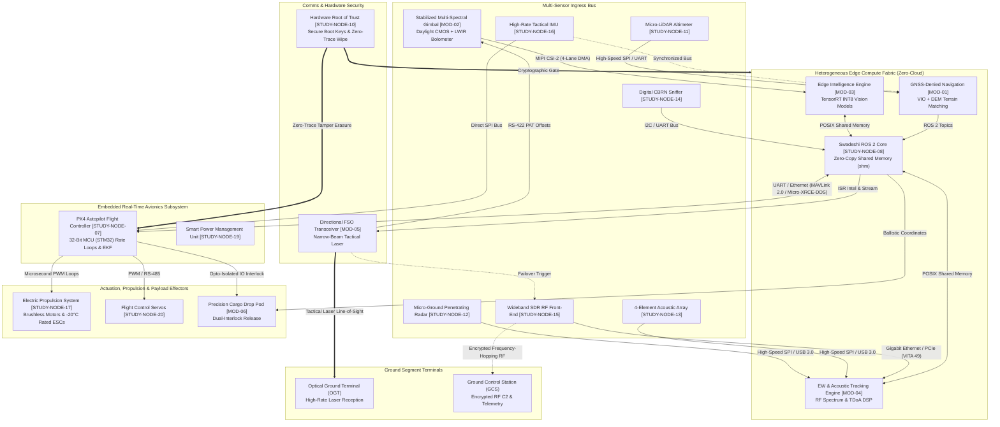

# Day 1, Task 1: Cross-Domain Architecture & Data Flow Topology Study

**Platform:** RudraEdge RE-T1 (Spectra) Tactical Autonomous UAV  
**Organization:** RudraEdge Aerospace (Incubated at TIDES, IIT Roorkee)  
**Cadre:** Priyanka Sharma, Systems Requirements & Configuration Engineer  
**Task Order Reference:** `REA/2026/RE-T1/TRAIN-001/ADD-03`  
**Status:** DRAFT BASELINE FOR TECHNICAL REVIEW  

---

## 1. Directory Purpose & Engineering Scope

This directory (`day1_task1_architecture_study/`) contains the architectural analysis and systems engineering decomposition for the **RudraEdge RE-T1 (Spectra)** autonomous tactical UAV platform.

The primary engineering objective of Task 1 is to execute a comprehensive technical study of the UAV's cross-domain capabilities, multi-sensor interfaces, embedded compute fabric, and flight avionics, and to produce a unified, formal systems topology map.

---

## 2. Primary Deliverable Output

> ### **Architecture & Data Flow Topology Map: A comprehensive block diagram illustrating the entire multi-sensor bus and UAV data flow.**

The core output of this task is the complete cross-domain architecture model structured under the **Physical-Electromagnetic-Cyber Layer Fusion (PECLF)** framework across 8 operational layers and 13 technical disciplines.

### Architecture Topology Diagram

---

## 3. Directory Contents & Artifact Registry

| File Name | Format | Description | Status |
| :--- | :---: | :--- | :--- |
| **[`RE_T1_CROSS_DOMAIN_ARCHITECTURE.mmd`](./RE_T1_CROSS_DOMAIN_ARCHITECTURE.mmd)** | Mermaid | Master standalone topology map rendering the entire multi-sensor bus, compute pipelines, avionics bridges, and external terminals. | **COMPLETED** |
| **[`RE_T1_CROSS_DOMAIN_ARCHITECTURE_STUDY.md`](./RE_T1_CROSS_DOMAIN_ARCHITECTURE_STUDY.md)** | Markdown | 12-section technical study covering PECLF framework, interface schemas, computational budgets, and failure-mode trees. | **COMPLETED** |
| **[`TECHNICAL_NODE_REGISTER.csv`](./TECHNICAL_NODE_REGISTER.csv)** | CSV | Registry of 22 engineering nodes categorized across hardware, software, payload, and ground communication assets. | **COMPLETED** |
| **[`RE_T1_ARCHITECTURE_OPEN_QUESTIONS.csv`](./RE_T1_ARCHITECTURE_OPEN_QUESTIONS.csv)** | CSV | Ledger of 15 architectural clarification questions, risks, and recommended engineering resolutions. | **COMPLETED** |

---

## 4. Key Technical Systems Decomposed

1. **Multi-Sensor Bus Architecture**: High-throughput perception ingestion utilizing MIPI CSI-2 for uncompressed EO/IR video, SPI/UART for precision micro-LiDAR altitude telemetry, high-rate SPI for tactical IMU inertial data, and high-speed VITA 49 packet streaming over Ethernet/PCIe for wideband RF SDR.
2. **Heterogeneous Edge Compute Fabric**: Onboard edge compute running hardened Linux with POSIX real-time extensions, hosting zero-copy shared memory pipelines between TensorRT INT8 vision inference, EW acoustic/RF signal processing, and visual-inertial odometry.
3. **Avionics & Real-Time Bridging**: Deterministic flight control execution on a dedicated 32-bit aerospace MCU (STM32) running PX4 Autopilot, coupled to the mission compute fabric via Micro-XRCE-DDS and MAVLink 2.0 with heartbeat monitoring.
4. **Resilient Communications**: High-bandwidth narrow-beam Free-Space Optical (FSO) laser communications to Optical Ground Terminals with pointing, acquisition, and tracking (PAT) feedback, backed by an encrypted frequency-hopping RF SDR datalink.
5. **Silicon Security**: Hardware Root of Trust (RoT) cryptographic boot enforcement, bus-level memory encryption, and tamper-activated zero-trace solid-state electrical sanitization.
