# RE-T1 CROSS-DOMAIN ARCHITECTURE STUDY
## Technical Evaluation, Subsystem Topology, and Multi-Sensor Data-Flow Mapping

---

## 1. Document Control

| Attribute | Specification / Value |
| :--- | :--- |
| **Project Identity** | RudraEdge RE-T1 (Spectra) / Project Rudra-Tactical (`RE-iDEX-PROPOSAL-2026-R1`) |
| **Task Assignment** | Day 1, Task 1: RE-T1 Cross-Domain Architecture Study |
| **Task Order Reference** | `REA/2026/RE-T1/TRAIN-001/ADD-03` (Dated: 09 October 2026) |
| **Author / Candidate** | **Priyanka Sharma** |
| **Designation** | Systems Requirements & Configuration Engineer |
| **Organization** | RudraEdge Aerospace (Incubated at TIDES, IIT Roorkee) |
| **Authorizing Authority** | Sarvesh Sharma, Founder & Project Lead |
| **Document Identifier** | `REA-T1-ARCH-STUDY-2026-V1.0` |
| **Document Date** | 10 October 2026 |
| **Classification** | Commercial-in-Confidence / Technical Reference |
| **Document Status** | **DRAFT FOR REVIEW** |
| **Applicable Lifecycle Stage** | Milestone 1 (M1–M4): Simulation Digital Twin & SRS Freeze |

---

## 2. Executive Summary

This **Cross-Domain Architecture Study** delivers the foundational systems engineering analysis for the **RudraEdge RE-T1 (Spectra)** autonomous tactical Unmanned Aerial Vehicle (UAV). Commissioned under Pre-Implementation Technical Readiness & Training Task Order `REA/2026/RE-T1/TRAIN-001/ADD-03`, this study establishes the technical baseline prior to physical fabrication and procurement, in accordance with the project's strict zero-cost research and local validation framework.

The primary source of truth utilized for this evaluation is technical dossier `REA-T1-OVERVIEW-2026-V1.0` (*RudraEdge RE-T1 (Spectra) Project Introduction & Technical Overview*). The analysis confirms that RE-T1 is not an assembly of off-the-shelf commercial drone components, but an integrated **Physical-Electromagnetic-Cyber Layer Fusion (PECLF)** architecture organized across **eight functional layers** and **thirteen distinct engineering disciplines**. The platform is specifically optimized for extreme high-altitude, low-temperature, and contested electronic warfare (EW) mountain environments such as Ladakh and the Siachen Glacier.

### Key Architectural Findings:
1. **Decoupled Flight Avionics and Mission Intelligence**: Flight-critical stabilization loops execute bare-metal on a dedicated 32-bit automotive/aerospace microcontroller (STM32 family running PX4 Autopilot), strictly air-gapped from high-level artificial intelligence algorithms running on a heterogeneous Linux compute host.
2. **True GNSS-Denied Navigation**: Resilient localization is achieved through hardware-synchronized Visual-Inertial Odometry (VIO), high-rate Inertial Measurement Unit (IMU) fusion, and onboard Digital Elevation Model (DEM) terrain correlation, completely eliminating dependency on satellite GPS signals.
3. **Multi-Domain Electromagnetic & Optical Resilience**: High-bandwidth data transfer relies on directional Free-Space Optical (FSO) laser communications, bypassing RF jamming, with encrypted Software-Defined Radio (SDR) frequency hopping serving strictly as a secondary fallback. Electronic support measures cover 400 MHz to 6 GHz.
4. **Data Sovereignty and Zero-Trace Sanitization**: Cryptographic hardware root-of-trust silicon enforces secure boot keys and immediate automated memory purging upon unauthorized physical breach or capture detection.

### Critical Identified Gaps & Limitations:
While the functional allocations are rigorously described, detailed engineering parameters—including exact mechanical dimensions, total mass budget, propulsion geometry (multirotor vs. hybrid fixed-wing), link handover hysteresis between FSO and RF, and full numerical mapping of all 20 frozen iDEX capabilities—remain unspecified in the high-level overview. Consequently, the architecture generated herein is designated as **PRELIMINARY ARCHITECTURE - SUBJECT TO VERIFICATION**.

---

## 3. Objective and Scope

### 3.1 Purpose
The objective of this architecture study is to:
- Conduct an exhaustive, evidence-based decomposition of all technical systems, subsystems, and nodes comprising the RE-T1 platform.
- Map the data flows, bus topologies, and hardware-software interface vectors between the disparate engineering domains.
- Establish the baseline Technical Node Register (`TECHNICAL_NODE_REGISTER.csv`) and Open Questions Register (`RE_T1_ARCHITECTURE_OPEN_QUESTIONS.csv`).
- Formulate the prerequisite architectural foundation for Day 1, Task 2 (*System Requirements Structure Setup*).

### 3.2 In-Scope Items
- Detailed review of the RE-T1 operational concept, environmental parameters, and iDEX project pillars.
- Identification of documented technical domains and assignment of systematic technical nodes.
- Detailed evaluation of the 8-layer PECLF framework and 7-stage end-to-end operational information pipelines.
- Verification of safety isolation mechanisms between non-critical AI tasks and mission-critical flight loops.
- Formulation of the system-level Mermaid architecture diagram (`RE_T1_CROSS_DOMAIN_ARCHITECTURE.mmd`).

### 3.3 Out-of-Scope Items
- Direct hardware purchasing, supplier vendor selection, or commercial component ordering.
- Modification of existing codebases, execution of unverified firmware binaries, or physical benchtop testing.
- Generation of speculative technical specifications not traceable to official project documents.

---

## 4. Source Documents Reviewed

The findings in this report are strictly derived from the official project files and authoritative administrative documents provided in the workspace:

| Document Identifier | Document Title / Content | Author / Originator | Formal Status | Evidence Contribution |
| :--- | :--- | :--- | :--- | :--- |
| `REA-T1-OVERVIEW-2026-V1.0` | RudraEdge RE-T1 (Spectra) Project Introduction & Technical Overview (12 Pages) | Sarvesh Sharma (Founder & Project Lead) | Baseline Technical Reference | Primary source of truth for PECLF layers, subsystem modules, protocols, lifecycle, and validation ladder. |
| `REA/2026/RE-T1/TRAIN-001/ADD-03` | Pre-Implementation Technical Readiness & Training Task Order (09 Oct 2026) | Sarvesh Sharma (Project Lead, RudraEdge Aerospace) | Legally Binding Directive | Mandates candidate cadre role, 7-day schedule, zero-cost policy, and Task 1 deliverable requirements. |
| `RE-iDEX-PROPOSAL-2026-R1` | Master iDEX Proposal Reference (Cited throughout Overview) | RudraEdge Aerospace / MoD iDEX-DIO | Referenced Parent Document | Establishes the 20 frozen advanced capabilities and D1–D20 deliverable commitments. |

*Limitation Note*: The master iDEX proposal document (`RE-iDEX-PROPOSAL-2026-R1`) was not provided as a standalone separate file in the workspace; its parameters were analyzed solely through direct citations and frozen feature references embedded within `REA-T1-OVERVIEW-2026-V1.0`. No unreadable or corrupted files were encountered during workspace inspection.

---

## 5. System Overview

### 5.1 System Concept and Operational Need
The **RudraEdge RE-T1 (Spectra)** is an autonomous, tactical-class Unmanned Aerial Vehicle (UAV) developed by RudraEdge Aerospace (incubated at TIDES, IIT Roorkee). The platform addresses acute operational challenges encountered by Indian Armed Forces along contested high-altitude border frontiers, specifically across **Ladakh and the Siachen Glacier**. 

Legacy tactical and commercial off-the-shelf (COTS) UAVs exhibit catastrophic vulnerabilities in these theaters:
1. **Satellite Denial**: Severe GNSS jamming and spoofing lead to lost navigation vectors and fatal fly-aways.
2. **Extreme Atmospheric Degradation**: Sub-zero temperatures (-20°C and lower), extreme wind shear, and thin air reduce aerodynamic lift by over 30%, suppress brushless motor output, and collapse unconditioned battery chemistry.
3. **RF Detection & Sniffing**: High-bandwidth RF video downlinks saturate congested wireless bands and expose flight paths to hostile Electronic Support Measures (ESM) direction finders.
4. **Foreign Hardware/Firmware Vulnerabilities**: Reliance on closed-source foreign flight controllers and imported microchips presents severe cybersecurity backdoors and supply-chain kill-switch hazards.

### 5.2 System Boundaries and Operating Environment
- **Operational Boundaries**: The airborne platform operates entirely air-gapped without relying on cloud processing or ground-based compute pipelines. Sensor processing, state estimation, target recognition, and flight autonomy are hosted 100% onboard.
- **External Interfaces**:
  - *Optical Ground Terminal (OGT)*: Narrow-beam, line-of-sight directional laser optical transceiver terminal.
  - *Ground Control Station (GCS) SDR Backup*: Encrypted, frequency-hopping radio link for emergency telemetry and abort commands.
  - *Atmospheric & Physical Environment*: Sub-zero mountain atmosphere, adverse weather (fog, dust, snow), high-vibration aerodynamic forces, and active adversary electronic warfare (RF jamming).

---

## 6. Architecture and Technical Domains

The technical architecture is structured under the **Physical-Electromagnetic-Cyber Layer Fusion (PECLF)** framework. This framework spans 13 verified multidisciplinary engineering domains:

```
               [LAYER H: CYBERSECURITY & DATA SOVEREIGNTY]
               Secure Boot • Hardware RoT • Zero-Trace Memory Wipe
                                       │
            ┌──────────────────────────┴──────────────────────────┐
            ▼                                                     ▼
 [LAYER E: SECURE COMMS]                               [LAYER G: EFFECTORS]
 FSO Laser Link • Resilient SDR                         Precision Cargo Drop Pod
            │                                                     ▲
            ▼                                                     │
 [LAYER D: ELECTROMAGNETIC AWARENESS]                  [LAYER F: AI & INTEL]
 RF Spectrum Sensing • TDoA Acoustic                   Semantic Seg • Change Det
            │                                                     ▲
            └──────────────────────────┬──────────────────────────┘
                                       │
            ┌──────────────────────────┴──────────────────────────┐
            ▼                                                     ▼
 [LAYER C: HETEROGENEOUS COMPUTE]                      [LAYER B: NAVIGATION]
 CPU / GPU / NPU / DSP Edge Matrix                     VIO • DEM Matching • PX4
                                       ▲
                                       │
                     [LAYER A: PHYSICAL PERCEPTION]
                     EO/IR • LiDAR • Micro-GPR • Mics • CBRN
```

### Breakdown of the 13 Documented Technical Domains:

1. **Artificial Intelligence & Deep Learning**: Onboard neural inference using PyTorch and TensorRT INT8 models for semantic segmentation, target re-identification, temporal change detection, and super-resolution.
2. **Computer Vision & Image Processing**: Real-time multi-spectral alignment between daylight CMOS and uncooled Long-Wave Infrared (LWIR) bolometer streams, feature tracking, and visual odometry pre-processing.
3. **Navigation & Sensor Fusion**: Drift-bounded 6-DOF state estimation fusing high-rate IMU angular rates, visual tracking features, micro-LiDAR altimetry, and onboard Digital Elevation Models (DEM) via Kalman filtering.
4. **Embedded Systems & Avionics**: 32-bit automotive/aerospace microcontrollers (STM32 series) executing inner-loop attitude control, actuator PWM signal generation, and MAVLink telemetry routing.
5. **RF & Digital Signal Processing (DSP)**: Wideband RF processing (400 MHz to 6 GHz) over Software-Defined Radio, FIR/IIR filtering, and Time-Difference-of-Arrival (TDoA) acoustic localization.
6. **Aerospace & Flight Dynamics**: Cold-weather high-thrust electric propulsion, low-Reynolds high-altitude aerodynamic design, and dynamic attitude control surfaces (servo fins).
7. **Optical Communications (FSO)**: Directional narrow-beam Free-Space Optical transceivers utilizing Coarse-Fine Pointing, Acquisition, and Tracking (PAT) to bypass RF jamming.
8. **Sensors & Tactical Payloads**: Gyro-stabilized dual EO/IR gimbal, lightweight micro-LiDAR, micro-Ground Penetrating Radar (GPR), 4-element microphone array, and digital CBRN sniffer.
9. **Cybersecurity & Cryptography**: Hardware Root of Trust, cryptographically signed boot keys, encrypted memory partitions, and automated zero-trace flash memory sanitization.
10. **Software & Data Systems**: Hardened air-gapped Linux operating system, Swadeshi ROS 2 middleware, POSIX shared memory inter-process communications, and Micro-XRCE-DDS bridge.
11. **Simulation & Digital Twin**: High-fidelity Gazebo simulation models replicating Himalayan mountain elevation profiles, wind turbulence, and PX4 Software-in-the-Loop (SIL) setups.
12. **Materials & Mechanical Mechatronics**: Faceted low-RCS carbon-composite airframe, radar-absorbing materials (RAM), ballistic-resilient self-healing polymers, and wind-compensated release pods.
13. **Systems Engineering & Safety**: 10-Tier Validation Ladder, frozen iDEX requirement traceability (D1–D20), fail-safe fallback modes, and hardware watchdog monitors.

---

## 7. Technical Node Analysis

A total of **22 discrete technical nodes** have been formally isolated and registered in `TECHNICAL_NODE_REGISTER.csv`. These encompass 6 official subsystem modules, 14 study-level internal hardware/software components, and 2 external ground segment nodes.

### Table 7.1: Consolidated Technical Node Registry

| Node ID | Component Name | Domain | Type | Primary Function | Documented Interfaces | Evidence Status |
| :--- | :--- | :--- | :--- | :--- | :--- | :--- |
| **MOD-01** | GNSS-Denied Localization & Navigation (`VIO-NAV`) | Navigation & Sensor Fusion | Software Pipeline | 6-DOF pose estimation without drift in jammed zones | ROS 2 Topics, Micro-XRCE-DDS, POSIX shm | Confirmed (Feature 1) |
| **MOD-02** | Stabilized Multi-Spectral Perception (`EO-IR-GIMBAL`) | Sensors & Payloads | Hardware / Software | Continuous day/night stabilized surveillance & targeting | MIPI-CSI Gen3, RS-422 gyro offsets | Confirmed (Features 5, 13) |
| **MOD-03** | Heterogeneous Edge Intelligence Engine (`EDGE-AI`) | AI & Deep Learning | Software Engine | Real-time segmentation, change detection & super-resolution | MIPI-CSI Gen3 DMA, POSIX shm, ROS 2 APIs | Confirmed (Features 8, 15, 17, 19) |
| **MOD-04** | Electromagnetic Sensing & Acoustic Tracking (`EW-DSP`) | RF & DSP | Signal Subsystem | Hostile RF characterization & acoustic gunfire TDoA bearing | PCIe / GbE (SDR), SPI / USB 3.0 (Audio) | Confirmed (Features 9, 11) |
| **MOD-05** | Secure Free-Space Optical Transceiver (`FSO-COMM`) | Optical Comms | Hardware / Software | Directional jam-proof laser communications | RS-422 (PAT), Laser Diode, RF fallback line | Confirmed (Feature 10) |
| **MOD-06** | Precision Cargo Drop Pod (`PAYLOAD-POD`) | Mechatronics / Payloads | Mechatronic Actuator | Wind-compensated logistic delivery & authorized effector drop | Opto-Isolated Solid-State IO, Mechanical latch | Confirmed (Features 6, 7) |
| **STUDY-NODE-07** | PX4 Autopilot Flight Controller MCU | Avionics / Flight Control | Embedded Firmware | Inner-loop attitude control, rate loops & failsafe watchdog | High-Speed UART / Ethernet, PWM pins | Confirmed Documented |
| **STUDY-NODE-08** | Swadeshi ROS 2 Middleware Core | Software & Data Systems | Software Middleware | Mission sequencing, IPC distribution, Micro-XRCE agent | Micro-XRCE-DDS, POSIX shm, Unix sockets | Confirmed Documented |
| **STUDY-NODE-09** | Heterogeneous Edge Compute Substrate | Compute / Avionics | Hardware Substrate | Zero-cloud multi-core CPU/GPU/NPU/DSP processing | MIPI-CSI, PCIe, GbE, SPI, USB, UART | Confirmed Documented |
| **STUDY-NODE-10** | Hardware Root of Trust & Wipe Engine | Cybersecurity | Hardware-Firmware | Boot signature verification & zero-trace memory wiping | Crypto silicon bus, Tamper switch sensor | Confirmed Documented |
| **STUDY-NODE-11** | Micro-LiDAR Altimeter & Rangefinder | Sensors / Navigation | Optical Transducer | Precision optical altitude clamping for VIO | High-Speed Serial / SPI | Confirmed Documented |
| **STUDY-NODE-12** | Micro-Ground Penetrating Radar (`GPR`) | Sensors / Payloads | Radar Subsystem | Subsurface anomaly & buried cache dielectric imaging | High-Speed SPI / USB 3.0 (16-bit IQ) | Confirmed Documented |
| **STUDY-NODE-13** | 4-Element Acoustic Microphone Array | Sensors / DSP | Acoustic Transducer | Synchronized impulse acoustic pressure capture for TDoA | High-Speed SPI / USB 3.0 (PDM audio) | Confirmed Documented |
| **STUDY-NODE-14** | Airborne CBRN Hazard Detection Sniffer | Sensors / Payloads | Chemical Sensor | Airborne chemical, biological, and radiation hazard mapping | I2C / UART / SPI digital bus | Confirmed Documented |
| **STUDY-NODE-15** | Wideband SDR RF Front-End (400 MHz–6 GHz) | RF & DSP / Comms | RF Hardware | Wideband spectrum interception & backup encrypted C2 | PCIe / Gigabit Ethernet (VITA 49) | Confirmed Documented |
| **STUDY-NODE-16** | High-Rate Inertial Measurement Unit (IMU) | Sensors / Navigation | Inertial Transducer | High-frequency 3-axis angular rates and accelerations | Dedicated SPI / CAN bus | Confirmed Documented |
| **STUDY-NODE-17** | Cold-Weather Electric Propulsion & ESCs | Aerospace / Propulsion | Mechatronic Actuator | High-thrust aerodynamic propulsion in thin air down to -20°C | PWM Timers, DC Power Bus, Telemetry | Confirmed Documented |
| **STUDY-NODE-18** | Faceted Low-RCS Composite Airframe | Materials / Aerospace | Structural Airframe | Low radar cross-section, thermal housing & structural mount | Mechanical airframe mounts, RAM coating | Confirmed Documented |
| **STUDY-NODE-19** | Low-Temp Insulated Battery Pack & PMU | Embedded Systems / Power | Power Subsystem | Multi-rail regulated power and battery thermal management | High-current DC bus, SMBus / I2C / CAN | Confirmed Documented |
| **STUDY-NODE-20** | Flight Control Servo Fin Actuators | Aerospace / Mechatronics | Aerodynamic Actuator | Deflection of aerodynamic control surfaces in high wind | PWM Pin mapping / RS-485 serial bus | Confirmed Documented |
| **STUDY-EXT-01** | Optical Ground Terminal (OGT) | Optical Comms (Ground) | External System | Reception of line-of-sight laser video & telemetry uplink | Directional Free-Space Optical laser beam | Confirmed Documented |
| **STUDY-EXT-02** | Ground Control Station (GCS) SDR RF Terminal | Comms (Ground) | External System | Encrypted frequency-hopping backup telemetry and commands | Encrypted RF link (400 MHz - 6 GHz) | Confirmed Documented |

---

## 8. Component Interfaces and Dependencies

The RE-T1 system architecture implements strict interface boundaries to ensure high data throughput while maintaining complete architectural isolation for flight safety.

### 8.1 Hardware & Software Interface Vectors (Section 8 Verification)

```
+------------------------+--------------------------+-------------------------------+--------------------------------------------+
| Interface Vector       | Physical Protocol        | Data Format / Bus Spec        | Integration Safety Protocol                |
+------------------------+--------------------------+-------------------------------+--------------------------------------------+
| Vision to Edge AI      | MIPI-CSI Gen3 (Multi)    | Raw YUV / RGB / 14-bit Thermal| DMA Direct Memory Access (zero frame drop) |
| Micro-GPR & Acoustic   | High-Speed SPI / USB 3.0 | 16-bit IQ & Audio PDM Arrays  | Dedicated DSP thread with prioritized FIFO |
| Autopilot to Compute   | High-Speed UART / Eth    | MAVLink 2.0 / Micro-XRCE-DDS  | Hardware watchdog heartbeats & link fallback|
| SDR RF Ingress         | Gigabit Ethernet / PCIe  | VITA 49 Radio Transport Pkts  | Strict RF shielding (EMI gaskets)          |
| Effector Interlock     | Opto-Isolated Solid-State| Dual-Redundant Discrete Logic | Hardware interlock preventing boot release |
| Optical FSO Gimbal     | RS-422 / High-Speed Ser  | High-Rate Gyro Offsets        | Closed-loop coarse-fine beam tracking PAT  |
+------------------------+--------------------------+-------------------------------+--------------------------------------------+
```

### 8.2 Architectural Safety Firewalls
1. **Asynchronous Thread Isolation**: The primary flight stabilization stack (PX4) runs on a dedicated bare-metal STM32 microcontroller. It is completely isolated from the non-real-time Linux operating system running on the heterogeneous compute substrate.
2. **Zero-Overhead Watchdog**: If an onboard neural network model experiences memory thrashing, core segmentation faults, or software freezes, the PX4 flight controller continues nominal waypoint navigation or executes autonomous return-to-home (RTH) without degradation.
3. **Air-Gapped Inter-Process Networking**: Intra-system communication between Swadeshi ROS 2 nodes and AI inference engines occurs strictly over local POSIX shared memory (`shm`) or Unix domain loopback sockets. All unvetted external IP networks are prohibited.

---

## 9. Data Flow Analysis

The end-to-end information flow follows seven deterministic operational stages, routing physical signals into actionable tactical outputs without external cloud computation.

```
Stage 1: Ingress (Photons, RF Waves, Acoustic Waves, Soil Echoes, Air Samples)
   │
   ▼
Stage 2: Sensing & Conditioning (MIPI-CSI DMA, ADC FIR Filtering, Audio PDM Slicing)
   │
   ▼
Stage 3: Local Bus Stream (MAVLink 2.0, Micro-XRCE-DDS, POSIX Shared Memory)
   │
   ▼
Stage 4: Estimation & AI Decision (VIO-NAV Pose, INT8 Semantic Masks, TDoA Vectors)
   │
   ▼
Stage 5: Control & Actuation (Microsecond PWM Motor Speed, Servo Deflection, Drop Pod)
   │
   ▼
Stage 6: Secure Transmission (Directional FSO Laser Beam, Fallback Encrypted SDR RF)
   │
   ▼
Stage 7: Audit & Verification (Continuous Diagnostics, Tamper Triggered Zero-Trace Wipe)
```

### Table 9.1: End-to-End Operational Data Flows

| Stage | Data Ingested | Processing Mechanism | Output Deliverable | Target Node |
| :--- | :--- | :--- | :--- | :--- |
| **1. Ingress & Sensing** | Optical/LWIR photons, raw microvolt RF, acoustic pressure waves, radar pulses, air samples | Hardware capture via MIPI-CSI, SDR ADC registers, and analog transducer channels | Raw synchronized byte streams and frame buffers | `MOD-02`, `STUDY-NODE-12`, `13`, `14`, `15` |
| **2. Conditioning** | Raw byte frames, uncalibrated analog voltages | Digital FIR filtering, OpenCV contrast stretching, coordinate transformations | Normalized tensor matrices and calibrated engineering units | `STUDY-NODE-09` (Compute) |
| **3. Fusion & Estimation** | Conditioned image tensors, IMU acceleration curves, DEM rasters, acoustic deltas | Visual-Inertial Odometry, DEM terrain alignment, TensorRT INT8 segmentation, temporal CNNs | 6-DOF vehicle pose, detected bounding boxes, acoustic bearing vectors | `MOD-01`, `MOD-03`, `MOD-04` |
| **4. Control & Flight** | Kinematic position errors, waypoint directives, ballistic release calculations | PX4 attitude control loops, wind compensation algorithms, dual safety interlocks | Microsecond PWM motor speed commands, servo deflections, release signals | `STUDY-NODE-07` -> `STUDY-NODE-17`, `20`, `MOD-06` |
| **5. Secure Transmission** | Target coordinates, change alerts, high-resolution video streams, health packets | FSO laser coarse-fine PAT modulation, SDR frequency-hopping RF encoding | Directional optical laser beam; encrypted RF backup packets | `MOD-05` -> `STUDY-EXT-01`, `15` -> `EXT-02` |
| **6. Continuous Audit** | Real-time CPU/thermal stats, tamper micro-switches, battery voltage | Hardware watchdog timers; automated zero-trace flash erasing daemons | Encrypted diagnostic logs; instant hardware sanitize on capture | `STUDY-NODE-10` (Crypto RoT) |

---

## 10. Architecture Diagram

The comprehensive system architecture has been generated in Mermaid format and stored at:
`day1_task1_architecture_study/RE_T1_CROSS_DOMAIN_ARCHITECTURE.mmd`

Due to unresolved physical parameters in the high-level source overview, the diagram is formally designated as:
**"PRELIMINARY ARCHITECTURE - SUBJECT TO VERIFICATION"**

### Embedded Mermaid Architecture Diagram:

```mermaid
flowchart TB
    subgraph HEADER ["SYSTEM ARCHITECTURE BASELINE (PRELIMINARY ARCHITECTURE - SUBJECT TO VERIFICATION)"]
        direction TB
        TITLE_NODE["RudraEdge RE-T1 (Spectra) Multi-Domain Tactical UAV<br/>8-Layer Physical-Electromagnetic-Cyber Layer Fusion (PECLF)<br/>Reference: REA-T1-OVERVIEW-2026-V1.0"]
    end

    subgraph EXT_BOUNDARY ["External Operational Boundaries (Ground Segment)"]
        direction LR
        EXT_OGT["[STUDY-EXT-01] Optical Ground Terminal (OGT)<br/>Line-of-Sight Laser Reception & PAT Tracking"]
        EXT_GCS["[STUDY-EXT-02] GCS Encrypted SDR RF Terminal<br/>Frequency-Hopping Backup Telemetry & C2"]
    end

    subgraph DOM_PERCEPTION ["Layer A: Physical Perception & Sensors (Hardware Substrate)"]
        direction TB
        MOD_02["[MOD-02] Stabilized Multi-Spectral Gimbal<br/>Daylight CMOS + LWIR Bolometer<br/>(Features 5 & 13)"]
        NODE_LIDAR["[STUDY-NODE-11] Micro-LiDAR Altimeter<br/>Terrain Clearance & Optical Ranging"]
        NODE_GPR["[STUDY-NODE-12] Micro-Ground Penetrating Radar<br/>Subsurface Target & Anomaly Imaging"]
        NODE_MIC["[STUDY-NODE-13] 4-Element Acoustic Array<br/>Impulse Noise / Gunfire Transducers"]
        NODE_CBRN["[STUDY-NODE-14] Digital CBRN Sniffer<br/>Airborne Chemical / Hazard Detector"]
        NODE_IMU["[STUDY-NODE-16] High-Rate Tactical IMU<br/>Angular Rates & Linear Accelerations"]
        NODE_SDR_FE["[STUDY-NODE-15] Wideband SDR RF Front-End<br/>400 MHz - 6 GHz Antenna Ingress"]
    end

    subgraph DOM_COMPUTE ["Layer C: Heterogeneous Edge Compute Fabric (Zero-Cloud Substrate)"]
        direction TB
        NODE_COMPUTE_HW["[STUDY-NODE-09] Heterogeneous Compute Substrate<br/>Multi-Core CPU / GPU / NPU / DSP<br/>Hardened Linux + POSIX RT Kernel"]
        MOD_03["[MOD-03] Edge Intelligence Engine (EDGE-AI)<br/>TensorRT INT8 Segmentation & Change CNNs<br/>(Features 8, 15, 17, 19)"]
        MOD_04["[MOD-04] EW & Acoustic Tracking (EW-DSP)<br/>RF Spectrum Occupancy & Acoustic TDoA<br/>(Features 9 & 11)"]
    end

    subgraph DOM_MIDDLEWARE ["Layer B / 3: Core Software, Navigation & Autonomy"]
        direction TB
        MOD_01["[MOD-01] GNSS-Denied Navigation (VIO-NAV)<br/>Visual-Inertial Odometry + DEM Terrain Matching<br/>(Feature 1)"]
        NODE_ROS2["[STUDY-NODE-08] Swadeshi ROS 2 Middleware Core<br/>Mission Sequencing, Inter-Process Comms<br/>& Micro-XRCE-DDS Host Agent"]
    end

    subgraph DOM_AVIONICS ["Layer 2: Embedded Real-Time Avionics Subsystem"]
        direction TB
        NODE_PX4["[STUDY-NODE-07] PX4 Autopilot Flight Controller<br/>Dedicated 32-Bit Automotive/Aerospace MCU (STM32)<br/>Inner Rate Loops, EKF & Failsafe Watchdog"]
    end

    subgraph DOM_COMMS ["Layer E: Jam-Resistant Secure Communications"]
        direction TB
        MOD_05["[MOD-05] Directional FSO Transceiver (FSO-COMM)<br/>High-Bandwidth Narrow-Beam Laser Link<br/>(Feature 10)"]
    end

    subgraph DOM_ACTUATION ["Layer G & 1: Actuation, Propulsion & Effectors"]
        direction TB
        NODE_PROP["[STUDY-NODE-17] Cold-Weather Electric Propulsion<br/>High-Thrust Brushless Motors & ESCs (-20°C)"]
        NODE_SERVO["[STUDY-NODE-20] Flight Control Servo Fins<br/>Aerodynamic Control Surface Actuation"]
        MOD_06["[MOD-06] Precision Cargo Drop Pod (PAYLOAD-POD)<br/>Wind-Compensated Ballistic Release<br/>(Features 6 & 7)"]
        NODE_AIRFRAME["[STUDY-NODE-18] Faceted Low-RCS Composite Airframe<br/>Carbon Monocoque & Self-Healing Matrix"]
        NODE_PMU["[STUDY-NODE-19] Low-Temp Insulated Battery & PMU<br/>Multi-Rail DC Power & Thermal Management"]
    end

    subgraph DOM_SECURITY ["Layer H: Cybersecurity & Data Sovereignty"]
        direction TB
        NODE_ROT["[STUDY-NODE-10] Hardware Root of Trust & Wipe Engine<br/>Cryptographic Boot Keys & Zero-Trace Sanitization"]
    end

    MOD_02 -->|"MIPI-CSI Gen3 (Multi-lane)<br/>DMA Direct Memory Access<br/>Raw YUV/RGB/14-bit Thermal"| MOD_03
    NODE_LIDAR -->|"High-Speed Serial / SPI<br/>Direct Range Data"| MOD_01
    NODE_GPR -->|"High-Speed SPI / USB 3.0<br/>16-bit IQ Samples (FIFO Ring)"| MOD_04
    NODE_MIC -->|"High-Speed SPI / USB 3.0<br/>Audio PDM Arrays"| MOD_04
    NODE_CBRN -->|"I2C / UART Digital Bus<br/>Hazard Concentration Flags"| NODE_ROS2
    NODE_SDR_FE -->|"Gigabit Ethernet / PCIe<br/>VITA 49 Transport Packets<br/>[EMI Gasket Shielded]"| MOD_04

    NODE_IMU -->|"Direct SPI Bus<br/>High-Rate Raw Gyro/Accel"| NODE_PX4
    NODE_IMU -.->|"High-Speed Synchronized Bus<br/>VIO Inertial Fusion [Unresolved Physical Route]"| MOD_01

    MOD_03 <-->|"POSIX Shared Memory (shm)<br/>Zero-Copy Virtual Memory"| NODE_ROS2
    MOD_04 <-->|"POSIX Sockets / ROS 2 Topics<br/>TDoA Vectors & RF Occupancy"| NODE_ROS2

    MOD_01 -->|"Kinematic Pose & Spatial Transforms<br/>ROS 2 Topics / Velocity Vectors"| NODE_ROS2

    NODE_ROS2 <-->|"High-Speed UART / Ethernet<br/>MAVLink 2.0 / Micro-XRCE-DDS<br/>[Watchdog Heartbeats]"| NODE_PX4

    NODE_PX4 -->|"Microsecond PWM Loops<br/>Motor Speed Commands"| NODE_PROP
    NODE_PX4 -->|"Microsecond PWM / RS-485<br/>Control Surface Deflection"| NODE_SERVO

    NODE_ROS2 -->|"Ballistic Trigger Coordinates<br/>& Wind Vectors"| MOD_06
    NODE_PX4 -->|"Opto-Isolated Solid-State IO<br/>Dual-Redundant Logic Interlock"| MOD_06

    NODE_COMPUTE_HW -->|"Serialized Mission Intel<br/>High-Priority Imagery"| MOD_05
    MOD_05 -->|"RS-422 Serial<br/>PAT Gyro Offsets"| MOD_02
    MOD_05 -.->|"Automated Fallback Trigger<br/>on Optical Obscuration [Threshold TBD]"| NODE_SDR_FE

    MOD_05 ==>|"Directional Narrow-Beam Laser<br/>Free-Space Optical (FSO) Line-of-Sight"| EXT_OGT
    NODE_SDR_FE -.->|"Encrypted Frequency-Hopping RF<br/>Backup Command & Status Link"| EXT_GCS

    NODE_ROT ==>|"Hardware-Enforced Cryptographic Gate<br/>Secure Boot & Memory Encryption Keys"| NODE_COMPUTE_HW
    NODE_ROT ==>|"Tamper-Triggered Electrical Wipe<br/>Zero-Trace Memory Erasure Interlock"| NODE_PX4

    NODE_PMU -.->|"Regulated DC Voltage Rails<br/>[Electrical Budget Envelope TBD]"| NODE_COMPUTE_HW
    NODE_PMU -.->|"High-Current Propulsion Bus<br/>[Discharge Rate TBD]"| NODE_PROP
    NODE_AIRFRAME -.->|"Mechanical Monocoque Enclosure<br/>Low-RCS & Passive Thermal Housing"| DOM_PERCEPTION
```



---

## 11. Requirements and Traceability

Section 10 of `REA-T1-OVERVIEW-2026-V1.0` mandates that every hardware specification and software module must trace directly to the **frozen iDEX proposal deliverables (D1 through D20)**.

### Table 11.1: Traceability Matrix (Confirmed Source Features)

| Feature ID | Documented Feature Description | Implementing Subsystem / Node | Verification Stage | Explicit Source Reference |
| :--- | :--- | :--- | :--- | :--- |
| **Feature 1** | GNSS-Denied Drift-Bounded Tactical Flight | `MOD-01` (`VIO-NAV`), `STUDY-NODE-16` (IMU) | Tier 8: GNSS-Denied Testing | Page 8, Section 7; Page 11 |
| **Feature 5** | Day/Night Stabilized Multi-Spectral Surveillance | `MOD-02` (`EO-IR-GIMBAL`) | Tier 4 & Tier 9 Integration | Page 8, Section 7; Page 9 |
| **Feature 6** | Precision Ballistic Cargo Delivery | `MOD-06` (`PAYLOAD-POD`) | Milestone 4 Beta Prototype | Page 8, Section 7; Page 10 |
| **Feature 7** | Authorized Defense Equipment Interlocked Control | `MOD-06` (`PAYLOAD-POD`), `STUDY-NODE-07` | Tier 4 Benchtop / Tier 9 | Page 8, Section 7; Page 9 |
| **Feature 8** | Real-Time Onboard Semantic Segmentation | `MOD-03` (`EDGE-AI`), `STUDY-NODE-09` | Tier 1 Algorithmic / Tier 9 | Page 8, Section 7; Page 11 |
| **Feature 9** | Hostile RF Emitter Characterization & ESM | `MOD-04` (`EW-DSP`), `STUDY-NODE-15` | Tier 4 Benchtop Integration | Page 8, Section 7; Page 9 |
| **Feature 10** | Directional Free-Space Optical Laser Data Transit | `MOD-05` (`FSO-COMM`), `STUDY-EXT-01` | Tier 9 Integrated Payload Runs | Page 8, Section 7; Page 11 |
| **Feature 11** | Impulse Acoustic Time-Difference-of-Arrival Tracking | `MOD-04` (`EW-DSP`), `STUDY-NODE-13` (4-Mic) | Tier 4 Benchtop / Tier 9 | Page 8, Section 7; Page 9 |
| **Feature 13** | Adverse Weather Target Acquisition (Fog/Dust/Snow)| `MOD-02` (`EO-IR-GIMBAL`) | Tier 5 Environmental Chamber | Page 8, Section 7; Page 11 |
| **Feature 15** | Temporal Visual Change Detection | `MOD-03` (`EDGE-AI`) | Tier 1 Simulation / Tier 9 | Page 8, Section 7; Page 11 |
| **Feature 17** | Neural Super-Resolution Imagery Reconstruction | `MOD-03` (`EDGE-AI`) | Tier 1 Simulation / Tier 9 | Page 8, Section 7; Page 11 |
| **Feature 19** | Autonomous Search & Rescue (SAR) Path Planning | `MOD-03` (`EDGE-AI`), `STUDY-NODE-08` | Tier 2 SIL Gazebo Mountain | Page 7, Section 6; Page 8 |
| **D1–D20** | Master iDEX Deliverables Package | All System Nodes (`MOD-01` to `STUDY-NODE-20`) | Tier 1 through Tier 10 | Page 11, Section 10 |

*Traceability Gap Analysis*: Features 2, 3, 4, 12, 14, 16, 18, and 20 are referenced as frozen capabilities within the master 20-capability framework but are not indexed with itemized headings in `REA-T1-OVERVIEW-2026-V1.0`. These gaps are recorded in the Open Questions Register (`RE_T1_ARCHITECTURE_OPEN_QUESTIONS.csv`, Item `Q-ARC-11`) and will be prioritized during Task 2 (*System Requirements Structure Setup*).

---

## 12. Configuration Considerations

Configuration control is managed according to strict systems engineering baselines established in Task Order `REA/2026/RE-T1/TRAIN-001/ADD-03`:

### 12.1 Existing Documented Configuration Items
- **Platform Identity**: RudraEdge RE-T1 (Spectra)
- **Project Proposal Reference**: `RE-iDEX-PROPOSAL-2026-R1`
- **Technical Overview Version**: `REA-T1-OVERVIEW-2026-V1.0` (Commercial-in-Confidence)
- **Development Schedule**: 18-Month Phased Lifecycle across 5 Milestones (M1: Months 1–4, M2: Months 5–8, M3: Months 9–12, M4: Months 13–16, M5: Months 17–18)
- **Quality Gates**: 10-Tier Validation Ladder (Tier 1 Software Models through Tier 10 MoD/iDEX Field Trials)

### 12.2 Indigenisation Configuration Baseline (Make-in-India 5-Tier Framework)
- **Software Middleware Baseline**: Swadeshi ROS 2 (guaranteeing 100% domestic IP ownership over communication nodes and message definitions).
- **Avionics Baseline**: Custom PX4 Autopilot modules running on automotive/aerospace STM32 microcontrollers.
- **Compute Substrate Migration Pathway**:
  - *Interim Baseline*: Heterogeneous COTS GPU/NPU/DSP module compiled with NVIDIA TensorRT (INT8 quantization).
  - *Target Sovereign Baseline*: Migration to **C-DAC VEGA** and **IIT Madras SHAKTI** processors (Section 2, Section 6, Section 11).
- **Code Promotion Discipline**: Strict prohibition against unreviewed merges; promotional gates require cryptographically signed repository commits and peer review.

---

## 13. Findings and Observations

1. **Hardware-Enforced Separation of Concerns**: The platform cleanly resolves the common drone vulnerability of "software bloat causing flight crashes." By isolating PX4 autopilot routines onto a dedicated bare-metal STM32 microcontroller and running Swadeshi ROS 2 and AI models on a separate Linux compute substrate, an out-of-memory error or AI crash cannot disrupt attitude control or recovery loops.
2. **Deterministic High-Speed Sensor Ingress**: High-bandwidth data channels (MIPI-CSI Gen3 DMA for video, PCIe/GbE for SDR, and SPI/USB 3.0 for GPR/Audio) completely bypass the host CPU operating system kernel overhead, utilizing direct memory access and prioritized FIFO buffers.
3. **Multi-Spectral Jamming Immunity**: The primary communication channel uses directional optical lasers (FSO) instead of RF, rendering hostile radio jamming completely ineffective against high-bandwidth data transfers. Radio transmission is restricted to encrypted frequency-hopping backup bursts.
4. **Physical Tamper Failsafe**: The inclusion of an emergency zero-trace cryptographic memory wiping mechanism provides total protection against data recovery if an aircraft crashes or is captured in hostile territory.
5. **Absence of Detailed Physical Envelope Data**: The overview dossier does not define basic dimensional envelopes (wingspan, length), maximum takeoff weight (MTOW), empty weight, or battery pack electrical capacity.

---

## 14. Open Questions and TBD Register

Twelve critical technical questions have been identified, compiled, and recorded in `RE_T1_ARCHITECTURE_OPEN_QUESTIONS.csv`. The table below outlines the highest-priority questions requiring engineering clarification:

| Question ID | Technical Domain | Related Node | Core Technical Question | Potential Impact |
| :--- | :--- | :--- | :--- | :--- |
| **Q-ARC-01** | Aerospace & Dynamics | `STUDY-NODE-18` / `20` | What is the definitive aerodynamic configuration (VTOL hybrid, multirotor, or fixed-wing)? | Dictates simulation aerodynamics in Gazebo and wind envelope limits. |
| **Q-ARC-02** | Compute & Avionics | `STUDY-NODE-09` | What is the interim COTS System-on-Module baseline prior to VEGA/SHAKTI silicon migration? | Blocks physical carrier board layout, thermal design, and bench harness assembly. |
| **Q-ARC-03** | Power & Thermal | `STUDY-NODE-19` | What is the total electrical power budget and battery capacity under -20°C cold-soak? | Risk of premature low-voltage cutoff or severe endurance degradation. |
| **Q-ARC-04** | Optical Comms | `MOD-05` / `STUDY-EXT-01` | What are the exact signal thresholds and timeout logic for falling back from FSO to SDR RF? | Risk of rapid link oscillation or transmission dropouts during bank turns. |
| **Q-ARC-05** | Avionics & Software | `STUDY-NODE-07` / `08` | Is high-speed UART or Ethernet the primary physical bus for the Micro-XRCE-DDS bridge? | Blocks completion of wiring harness pinouts and Micro-XRCE configuration. |
| **Q-ARC-09** | Cybersecurity | `STUDY-NODE-10` | What are the specific multi-factor sensor trigger criteria for zero-trace flash wiping? | Catastrophic hazard of accidental memory sanitization during hard mountain landings. |
| **Q-ARC-11** | Systems Engineering | All Nodes | What is the complete itemized definition of all 20 frozen iDEX capabilities and D1–D20 deliverables? | Incomplete requirements traceability prevents 100% verification coverage in Task 2. |

---

## 15. Risks and Limitations

### 15.1 Architectural and Project Risks
1. **Accidental Memory Sanitization Risk**: If the zero-trace wipe engine relies on unverified acceleration thresholds, a hard landing on rocky Himalayan terrain could trigger false-positive memory wiping, destroying proprietary flight firmware in the field.
2. **Propulsion Power Depletion at -20°C**: In high-altitude thin air (Ladakh/Siachen), electric motors require significantly higher rotational RPM to generate equivalent lift, increasing current draw while battery chemical capacity degrades due to cold soak.
3. **Optical Laser Pointing Drift in Turbulence**: Severe wind shear along mountain ridges could exceed the slew rate of the coarse-fine pointing, acquisition, and tracking (PAT) gimbal, causing repeated FSO link loss.
4. **Propeller Acoustic Saturation**: High motor RPM in thin air generates acoustic harmonics that could saturate the 4-element microphone array, masking gunfire impulse signals unless acoustic notch filtering is validated.

### 15.2 Analytical Limitations of this Study
- This study was conducted exclusively from high-level technical proposal documents (`REA-T1-OVERVIEW-2026-V1.0`). Detailed CAD geometry, schematic schematics, and numerical flight dynamics coefficients were not present in the workspace.
- Verification status marks items as *Confirmed Documented* based on their presence in authorized engineering literature, but hardware test verification awaits execution of the 10-Tier Validation Ladder.

---

## 16. Conclusion and Recommended Next Steps

### 16.1 Summary of Established Baseline
The available project evidence confirms that the **RudraEdge RE-T1 (Spectra)** represents an advanced, highly specialized tactical UAS architecture designed around an 8-layer PECLF framework. The integration of zero-cloud heterogeneous edge AI, drift-bounded VIO/DEM navigation, directional optical communications, and hardware-enforced data sovereignty directly resolves the core vulnerabilities of modern tactical drone operations.

### 16.2 Recommended Next Documentation Steps
1. **Authorize Technical Node Register**: Formally freeze `TECHNICAL_NODE_REGISTER.csv` as the baseline architectural inventory for Day 1 deliverables.
2. **Initiate Task 2 (System Requirements Structure Setup)**: Utilize the confirmed technical nodes, documented features (Features 1, 5, 6, 7, 8, 9, 10, 11, 13, 15, 17, 19), and D1–D20 deliverables to initialize the local Markdown System Requirements Specification (SRS) hierarchy.
3. **Issue Clarification Requests**: Submit `RE_T1_ARCHITECTURE_OPEN_QUESTIONS.csv` to Project Lead Sarvesh Sharma for resolution of aerodynamic layout (Q-ARC-01), interim compute hardware (Q-ARC-02), and power envelopes (Q-ARC-03).

---

## 17. References

1. **RudraEdge Aerospace Dossier**: `REA-T1-OVERVIEW-2026-V1.0`, *RudraEdge RE-T1 (Spectra) Project Introduction & Technical Overview*, authored by Sarvesh Sharma (Founder & Project Lead), October 2026:
   - Section 1: System Definition & Scope (Page 2)
   - Section 2: Problem Statement & Project Objectives (Page 3)
   - Section 3: High-Level System Architecture (Page 4)
   - Section 4: Major Technology Domains (Page 5)
   - Section 5: Information Transit & Operational Flow (Page 6)
   - Section 6: System Technology Stack (Page 7)
   - Section 7: Modular Functional Subsystems (Page 8)
   - Section 8: System Integration Architecture & Protocols (Page 9)
   - Section 9: Development Methodology & Budget Allocation (Page 10)
   - Section 10: Testing, Validation & Engineering Discipline (Page 11)
   - Section 11: Strategic Horizon & Summary (Page 12)
2. **Administrative Task Order**: `REA/2026/RE-T1/TRAIN-001/ADD-03`, *Pre-Implementation Technical Readiness & Training Task Order*, Issued to Priyanka Sharma, Systems Requirements & Configuration Engineer, 09 October 2026.
3. **Master Defense Proposal**: `RE-iDEX-PROPOSAL-2026-R1`, *Project Rudra-Tactical: Autonomous Tactical UAV Platform for High-Altitude Frontier Reconnaissance*, iDEX / DIO Framework.
