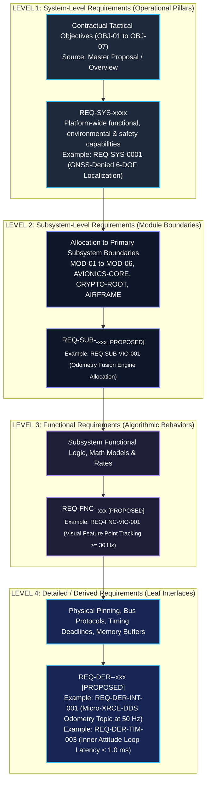
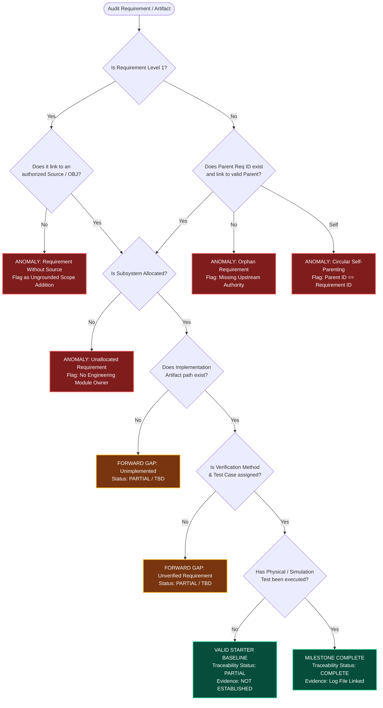
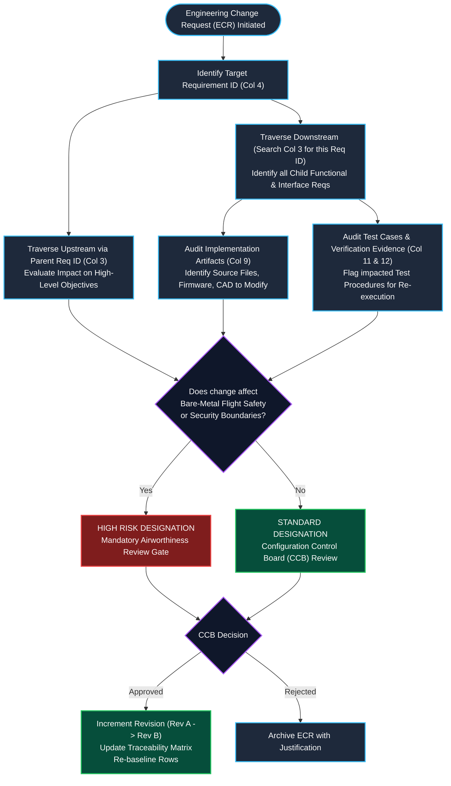

# Engineering Training Guide & Conceptual Notes: Day 2
## Task 3: Requirements Decomposition Framework & Task 4: Bidirectional Traceability Matrix

**Project Context:** RudraEdge Aerospace — RE-T1 (Spectra) / Rudra-Tactical  
**Assigned Engineer:** Priyanka Sharma (Systems Requirements & Configuration Engineer)  
**Milestone Date:** 11 October 2026 — Day 2  
**Applicable Task Order:** `REA/2026/RE-T1/TRAIN-001/ADD-03`  

---

## 1. Executive Summary & Core Objectives

In mission-critical aerospace and defense systems, software and hardware cannot be built from vague top-level concepts. Every flight function, sensor driver, communications protocol, and test procedure must be methodically decomposed and bidirectionally tracked.

This guide provides the complete **theoretical framework, practical workflows, architectural flowcharts, and technical notes** for:
1. **Task 3 (Requirements Decomposition Framework)**: Systematically breaking down high-level tactical mission goals into verifiable subsystem, functional, and derived engineering requirements.
2. **Task 4 (Bidirectional Mapping Matrix Design)**: Designing and operating a 16-column matrix that links source objectives down to code and test evidence (**Forward Traceability**), and verifies that every line of code and test case is contractually justified (**Backward Traceability**).

---

## 2. Master Architectural Flowcharts

### 2.1 Flowchart 1: 4-Level Requirements Decomposition Hierarchy
This flowchart illustrates how high-level tactical mission goals flow downward into discrete, verifiable engineering nodes across four distinct hierarchical levels:



---

### 2.2 Flowchart 2: End-to-End Bidirectional Traceability Loop
This flowchart maps the complete bidirectional loop: Forward Traceability ensuring objective fulfillment, and Backward Traceability ensuring contractual justification:


---

### 2.3 Flowchart 3: Traceability Gap & Anomaly Detection Logic
This flowchart illustrates the decision rules used by a Configuration Engineer to detect orphans, unallocated requirements, rogue code, and unverified links:



---

### 2.4 Flowchart 4: Engineering Change Impact Assessment Flow
This flowchart shows the workflow when a requirement modification or deletion is requested:



---

## 3. Deep-Dive Notes: Task 3 (Requirements Decomposition Framework)

### 3.1 Why Requirements Decomposition is Mandatory
In advanced tactical aerospace projects, high-level mission goals like *"Achieve continuous drift-bounded flight in satellite-jammed airspace"* cannot be directly coded or tested on a benchtop. 
* A flight software engineer cannot write C++ code for *"GNSS-Denied Flight"*.
* An embedded systems engineer cannot solder a bus harness for *"Indian IP Sovereignty"*.

**Requirements Decomposition** is the systematic process of breaking down high-level, multi-disciplinary operational goals into discrete, single-discipline, verifiable engineering specifications.

### 3.2 The 4-Level Requirement Hierarchy Explained

| Level | Formal Name | Scope and Engineering Definition | Typical Owner | Example Identifier |
| :---: | :--- | :--- | :--- | :--- |
| **Level 1** | **System-Level Requirements** | Defines platform-wide operational capabilities, environmental tolerances, airworthiness firewalls, and defense mission objectives. Direct children of contractual objectives (`OBJ-01` to `OBJ-07`). | Chief Systems Engineer / Aerospace Architect | `REQ-SYS-0001`<br/>`REQ-SYS-0013` |
| **Level 2** | **Subsystem-Level Requirements** | Allocates functional boundaries to a single physical module (`MOD-01` to `MOD-06`, `AVIONICS-CORE`, `CRYPTO-ROOT`, etc.). Specifies subsystem responsibilities without dictating internal algorithms. | Subsystem Lead / Hardware Architect | `REQ-SUB-VIO-001`<br/>`REQ-SUB-AVI-001` |
| **Level 3** | **Functional Requirements** | Specifies discrete internal behaviors, algorithmic models, sampling frequencies, mathematical filters, and data transformations executed by a subsystem. | Algorithm Lead / Firmware Engineer | `REQ-FNC-VIO-001`<br/>`REQ-FNC-AVI-001` |
| **Level 4** | **Detailed / Derived Requirements** | Leaf requirements detailing electrical interfaces, software transport protocols, memory sharing structures, timing deadlines, and hardware safety interlocks. | Driver Developer / Mechatronics Engineer | `REQ-DER-INT-001`<br/>`REQ-DER-TIM-003` |

### 3.3 The 17-Field Requirement Node Anatomy
Each requirement node in the SRS must contain 17 explicit fields to prevent ambiguity and ensure auditability:
1. **Requirement ID**: Permanent unique string (e.g., `REQ-SYS-0001`).
2. **Requirement Title**: Short descriptive title.
3. **Requirement Statement**: Strict normative engineering language using *shall* (never *should*, *could*, or *may*).
4. **Requirement Level**: Explicit tag (`Level 1`, `Level 2`, `Level 3`, `Level 4`).
5. **Parent Requirement ID**: Direct parent node ID. Prohibited from being empty (unless L1) or self-referencing.
6. **Source / Origin**: Formal document identifier, section, and page number.
7. **Requirement Type**: Classification (Functional, Performance, Interface, Safety, Security, etc.).
8. **Allocated Subsystem**: Physical module ownership (`MOD-01`, `MOD-02`, etc.).
9. **Rationale**: Technical explanation of *why* the requirement exists.
10. **Verification Method**: One of four formal engineering methods:
    * **Inspection (I)**: Visual audit of drawings, wiring, or code.
    * **Analysis (A)**: Calculations, simulation, link budgets.
    * **Demonstration (D)**: Qualitative verification without calibrated instruments.
    * **Test (T)**: Quantitative evaluation against measurable tolerances using calibrated instruments.
11. **Verification Status**: `UNEXECUTED`, `AWAITING TESTBENCH`, `PASSED`, `FAILED`. (Never claim passed without data).
12. **Child Requirement IDs**: List of immediate child IDs or `None (Leaf Node)`.
13. **Upstream Traceability**: Path ascending to the top-level mission objective.
14. **Downstream Traceability**: Path descending to leaf interfaces and validation tiers.
15. **Configuration / Baseline Status**: `DRAFT`, `PROPOSED`, `UNDER REVIEW`, `APPROVED`, `BASELINED`.
16. **Assumptions or Constraints**: Operating boundaries, sensor limits, environmental boundaries.
17. **Open Issues / TBD Items**: Tracking unconfirmed parameters (e.g., `ISSUE-REQ-001`).

### 3.4 Decomposition Integrity & Orphan Handling Rules
* **Rule 1: No Unlinked Children**: Every Level 2, 3, and 4 requirement must possess an explicit parent link.
* **Rule 2: Orphan Detection**: Any requirement lacking a confirmed parent is flagged `ORPHAN REQUIREMENT`. Orphans indicate unauthorized scope expansion ("gold-plating") or missing higher-level requirements.
* **Rule 3: Childless Parent Detection**: High-level requirements without decomposed children are flagged `CHILDLESS PARENT`. In Milestone 1, they must either be decomposed or justified as `ATOMIC / DIRECT VERIFICATION`.
* **Rule 4: Scope Preservation**: Decomposed children must never add unapproved capabilities that exceed the parent requirement's scope.

---

## 4. Deep-Dive Notes: Task 4 (Bidirectional Mapping Matrix Design)

### 4.1 Forward vs. Backward Traceability
Bidirectional traceability requires traversing the engineering data model in both directions:

```
[FORWARD TRACEABILITY: Objective-Driven]
Contract Objective  -->  System Req  -->  Subsystem  -->  Functional  -->  Interface  -->  Code/HW  -->  Test Case  -->  Evidence Log
"Did we build EVERYTHING that the tactical customer paid for?"

[BACKWARD TRACEABILITY: Justification-Driven]
Evidence Log  -->  Test Case  -->  Method  -->  Code/HW  -->  Interface  -->  Functional  -->  Subsystem  -->  System Req  -->  Contract Objective
"Is EVERY line of code and test case CONTRACTUALLY JUSTIFIED, or did someone introduce rogue features?"
```

### 4.2 The 16-Column Matrix Schema Explained

| Col # | Column Name | Engineering Function & Audit Question | Standard Permitted Values |
| :---: | :--- | :--- | :--- |
| **1** | **Source Reference** | What document authorizes this requirement? | Document ID + Section + Page (e.g., `REA-T1-OVERVIEW-2026-V1.0, Sec 2`) |
| **2** | **Source Requirement ID** | What top-level tactical goal originated this? | `OBJ-01` to `OBJ-07` or Proposal ID |
| **3** | **Parent Requirement ID** | What is the immediate upstream parent node? | `N/A — Top-Level Requirement` (L1) or Parent Req ID |
| **4** | **Requirement ID** | What is this requirement's unique identity? | `REQ-SYS-xxxx`, `REQ-SUB-xxxx`, `REQ-FNC-xxxx`, `REQ-DER-xxxx` |
| **5** | **Requirement Title** | What is the concise name of this requirement? | Standard Title String |
| **6** | **Requirement Level** | Where does this node sit in the hierarchy? | `Level 1`, `Level 2`, `Level 3`, `Level 4` |
| **7** | **Requirement Type** | What engineering discipline governs this? | `Functional`, `Performance`, `Interface`, `Safety`, `Security`, etc. |
| **8** | **Allocated Subsystem** | Which physical team or module owns this? | `MOD-01` to `MOD-06`, `AVIONICS-CORE`, `CRYPTO-ROOT`, etc. |
| **9** | **Implementation Reference** | Where does this requirement exist in physical files? | File path (`src/`, `firmware/`, `cad/`) or `TBD (Pre-Implementation)` |
| **10** | **Verification Method** | How will compliance be formally proven? | `Inspection`, `Analysis`, `Demonstration`, `Test` |
| **11** | **Test Case ID** | Which test procedure validates this requirement? | Formal Test ID (e.g., `TC-NAV-001`) or `TBD (Awaiting Testbench)` |
| **12** | **Verification Evidence** | Where are the signed, executed test logs stored? | File link / URI or `NOT ESTABLISHED (Unexecuted)` |
| **13** | **Forward Traceability Status** | Are all forward links down to test logs complete? | `COMPLETE`, `PARTIAL`, `GAP`, `NOT ASSESSED` |
| **14** | **Backward Traceability Status** | Does this link cleanly back to contractual source? | `COMPLETE`, `PARTIAL`, `GAP`, `NOT ASSESSED` |
| **15** | **Configuration / Baseline Status** | What is the change-control baseline state? | `DRAFT`, `PROPOSED`, `UNDER REVIEW`, `APPROVED`, `BASELINED` |
| **16** | **Open Issues / Remarks** | What parameters are unstated or under investigation?| Reference to Open Issues Register (`ISSUE-REQ-xxx`) |

### 4.3 Standard Status Dictionary
* **`COMPLETE`**: Every link in the chain is established and supported by empirical evidence.
* **`PARTIAL`**: Upstream and architectural links exist, but downstream implementation or verification evidence is pending execution (`TBD`).
* **`GAP`**: A required relationship is missing, broken, or unallocated.
* **`NOT ASSESSED`**: The row has not yet undergone formal configuration engineering review.

### 4.4 The 10 Traceability Anomalies Every Systems Engineer Must Detect

```
+-----------------------------------+-----------------------------------+-----------------------------------+
| ANOMALY TYPE                      | DETECTION SIGNATURE IN MATRIX     | ENGINEERING SEVERITY & REMEDY     |
+-----------------------------------+-----------------------------------+-----------------------------------+
| 1. Requirement Without Source     | Col 1 or Col 2 is empty / TBD     | CRITICAL: Unsubstantiated scope.  |
|                                   |                                   | Action: Solicit customer CR or drop.|
+-----------------------------------+-----------------------------------+-----------------------------------+
| 2. Orphan Requirement             | Col 3 is empty on Level 2/3/4     | CRITICAL: Disconnected child node.|
|                                   |                                   | Action: Trace to parent or reject.|
+-----------------------------------+-----------------------------------+-----------------------------------+
| 3. Circular Self-Parenting        | Col 3 == Col 4 (Parent == Req ID) | HIGH: Breaks decomposition tree.  |
|                                   |                                   | Action: Point to true upstream ID.|
+-----------------------------------+-----------------------------------+-----------------------------------+
| 4. Unallocated Requirement        | Col 8 (Allocated Subsystem) empty | HIGH: No engineering module owner.|
|                                   |                                   | Action: Assign physical subsystem.|
+-----------------------------------+-----------------------------------+-----------------------------------+
| 5. Unimplemented Requirement      | Col 9 (Implementation Ref) empty  | MEDIUM: Code omission risk.       |
|                                   |                                   | Action: Assign src/firmware path. |
+-----------------------------------+-----------------------------------+-----------------------------------+
| 6. Unverified Requirement         | Col 10 (Verification Method) empty| HIGH: Cannot certify for flight.  |
|                                   |                                   | Action: Define method & criteria. |
+-----------------------------------+-----------------------------------+-----------------------------------+
| 7. Missing Test Case              | Col 11 empty where Method is Test | MEDIUM: Testbench cannot execute. |
|                                   |                                   | Action: Author formal test script.|
+-----------------------------------+-----------------------------------+-----------------------------------+
| 8. Rogue Implementation           | Source code exists with no Req ID | CRITICAL: Gold-plating / defects. |
|                                   |                                   | Action: Delete code or draft ECR. |
+-----------------------------------+-----------------------------------+-----------------------------------+
| 9. Orphan Test Case               | Test script exists with no Req ID | MEDIUM: Wasted testbench runtime. |
|                                   |                                   | Action: Map to req or retire test.|
+-----------------------------------+-----------------------------------+-----------------------------------+
| 10. Broken Traceability Chain     | Forward or Backward marked GAP    | HIGH: Audit failure / blind spot. |
|                                   |                                   | Action: Re-link missing hierarchy.|
+-----------------------------------+-----------------------------------+-----------------------------------+
```

---

## 5. Summary of Deliverable Files in Day 2 Workspace

| File Name | Location | Primary Contents |
| :--- | :--- | :--- |
| **`Day2_Task3_Task4_Training_Notes_and_Flowcharts.md`** *(This File)* | `C:\Users\Admin\OneDrive\Desktop\Day2\` | Master engineering notes, 4 architectural flowcharts (Mermaid), 10 anomaly rules, and theoretical guides. |
| **`SRS_Starter_Template_Day2_2026-10-11.md`** | `C:\Users\Admin\OneDrive\Desktop\Day2\` and `docs/` | Complete 17-section SRS Starter Template with 17-field tracking nodes, 40-row parent-child register, and embedded 16-column matrix. |
| **`Bidirectional_Traceability_Wireframe_Day2_2026-10-11.md`** | `C:\Users\Admin\OneDrive\Desktop\Day2\` and `docs/` | Standalone 16-column Bidirectional Traceability Wireframe with 40 starter rows, traversal walkthroughs, and gap rules. |
| **`README.md`** | `C:\Users\Admin\OneDrive\Desktop\Day2\` | Workspace index and directory navigation summary. |

---

## 6. Engineering Integrity Statement
All flowcharts, notes, and schemas in this document reflect verified systems engineering methodologies and project records from `REA-T1-OVERVIEW-2026-V1.0`. All placeholder implementation references and test cases remain marked `TBD` / `NOT ESTABLISHED` in strict compliance with the zero-fabrication and local-only engineering mandate.
